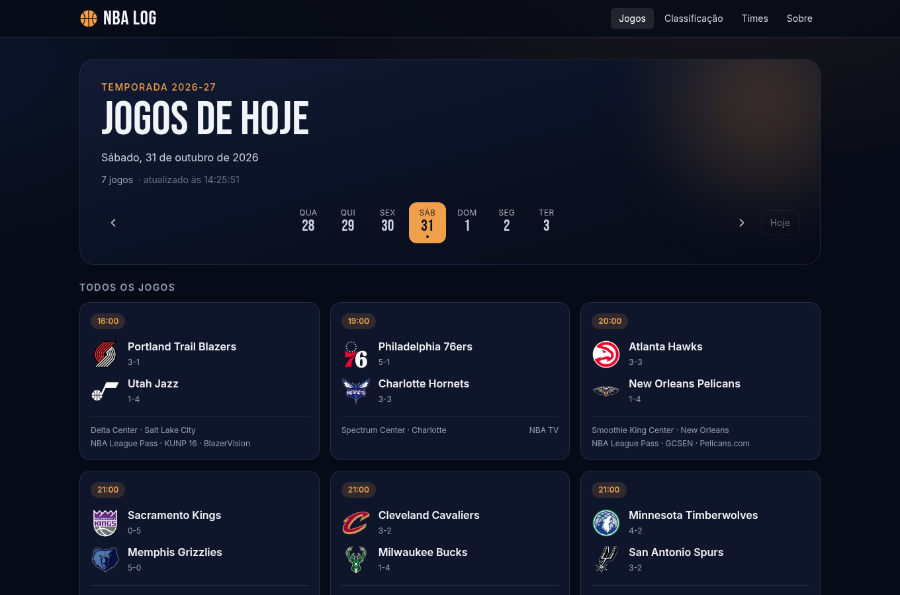
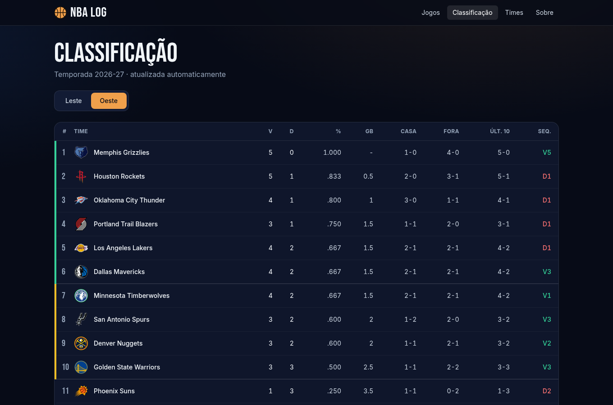
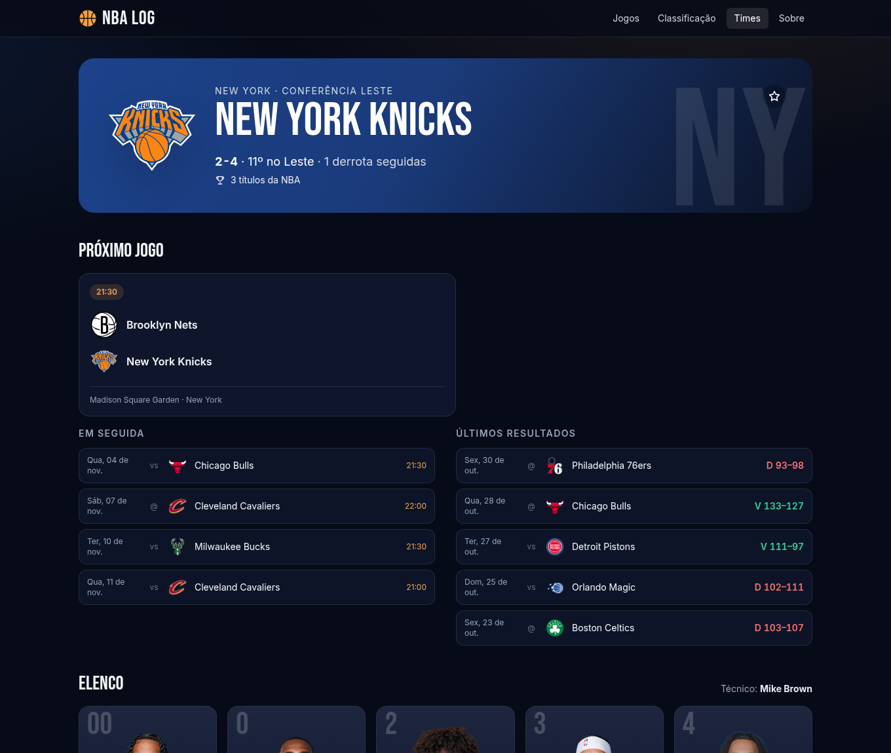
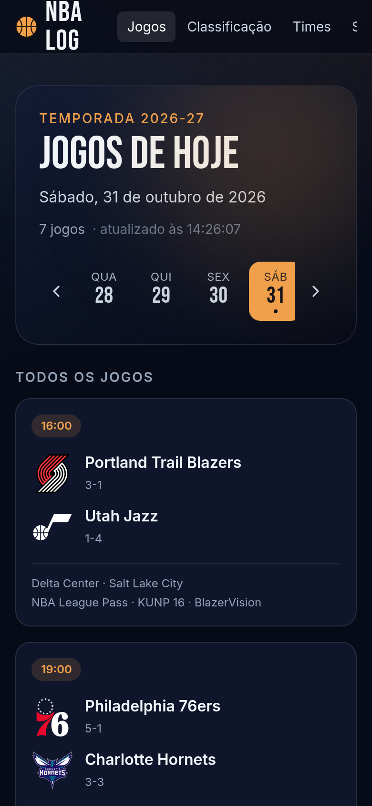

# NBA Log

Painel da NBA com **jogos ao vivo, classificação e os 30 times**: placares e calendário atualizados em tempo real,
elencos com fotos, campanha da temporada e títulos de cada franquia.

**Demo:** https://react-nba-pearl.vercel.app

| Jogos do dia | Classificação |
| --- | --- |
|  |  |

| Página do time | Celular |
| --- | --- |
|  |  |

## Recursos

- **Jogos do dia** com placar ao vivo (atualiza a cada 20 s), status (Q3 5:23, Intervalo, Encerrado, prorrogação), local,
  transmissão e navegação por dia; o dia escolhido fica na URL (`/?data=2026-06-13`).
- **Classificação** de Leste e Oeste com vitórias, derrotas, aproveitamento, jogos atrás, casa/fora, últimos 10 e
  sequência, destacando vaga direta (1º–6º) e play-in (7º–10º).
- **Os 30 times** com logo oficial, campanha, posição na conferência, busca, filtro por conferência, ordenação
  (nome, vitórias, títulos) e **favoritos** salvos no navegador.
- **Página de cada time**: próximo jogo (ou jogo ao vivo), próximos jogos, últimos resultados, **elenco com fotos**,
  técnico, e títulos (anos e por década).
- Funciona **offline com cache**: se a API cair, mostra a última versão salva e avisa que pode estar desatualizada.
- Design escuro e responsivo, com carregamento por *skeletons*, navegação por teclado e rótulos de acessibilidade.
- URLs da versão antiga (`/info/Boston Celtics`, `/jogadores/...`) continuam funcionando (redirecionam).

## De onde vêm os dados

API pública da ESPN (não oficial, sem chave): placar, calendário, classificação, elencos, logos e fotos. O navegador
**não** chama a ESPN diretamente (o CDN deles responde ao CORS de forma inconsistente); as chamadas passam por um proxy
do próprio site, `/api/espn/...`:

- **Vercel**: função serverless em [`api/espn.ts`](api/espn.ts). Só repassa os endpoints usados pelo app, valida o
  parâmetro de data e adiciona cache de borda (`s-maxage=10`).
- **Desenvolvimento** (`npm run dev` / `preview`): o próprio Vite faz o proxy (ver `vite.config.ts`).
- Se o proxy falhar, o app tenta a ESPN direto antes de recorrer ao cache local.

O "dia" dos jogos segue o fuso de Nova York (como a NBA); os horários aparecem no fuso do navegador. A contagem de
**títulos** é mantida em [`src/data/titulos.ts`](src/data/titulos.ts) (inclui os conquistados em cidades/nomes anteriores
da franquia) e precisa ser atualizada a cada temporada.

## Tecnologias

React 18 · TypeScript (strict) · Vite · Tailwind CSS · React Router · Vitest · ESLint

## Como executar

Requer Node.js 20+.

```bash
npm install
npm run dev       # http://localhost:5173
```

| Script | O que faz |
| --- | --- |
| `npm run dev` | servidor de desenvolvimento (com proxy da ESPN) |
| `npm run build` | checagem de tipos + build de produção |
| `npm run preview` | serve o build localmente |
| `npm run lint` | ESLint |
| `npm test` | testes unitários (Vitest) |

## Estrutura

```
api/espn.ts            proxy serverless da ESPN (Vercel) + testes
src/
├── data/titulos.ts    títulos por franquia
├── lib/
│   ├── espn.ts        normaliza as respostas da ESPN (funções puras, testadas com respostas reais)
│   ├── api.ts         cliente com cache em memória/localStorage, proxy e fallback
│   ├── useDados.ts    hook de carregamento, erro e atualização automática
│   ├── datas.ts       "dia NBA" (fuso de Nova York), formatação
│   ├── times.ts       busca, filtros, ordenação, estatísticas
│   └── __fixtures__/  respostas reais (reduzidas) da ESPN usadas nos testes
├── components/        GameCard, TeamCard, TeamLogo, PlayerCard, DaySelector...
└── pages/             Jogos, Classificação, Times, TimePage, Sobre
```

## Testes

`npm test` (30 testes) cobre os normalizadores com **respostas reais da ESPN** (jogo encerrado, agendado, ao vivo,
prorrogação, classificação, elenco, calendário), filtros e ordenação, datas no fuso de Nova York, a integridade da tabela
de títulos (79 campeões de 1947 a 2026, sem ano repetido) e o proxy (bloqueia caminhos e hosts não permitidos).
A CI do GitHub Actions roda lint, testes e build.

## Deploy

Na Vercel, importe o repositório: build `npm run build`, saída `dist`. O `vercel.json` reescreve `/api/espn/*` para a
função e o restante para o `index.html` (SPA). Depois do primeiro deploy, confira no preview se `/api/espn/v2/sports/basketball/nba/standings`
responde JSON.

## Limitações

- A API da ESPN é **não oficial** e pode mudar ou bloquear; por isso existem o cache local e o aviso de dados antigos.
- NBA, nomes e logos dos times e as imagens pertencem aos seus donos; este é um projeto de estudo, sem fins comerciais e
  sem vínculo com a NBA, os times ou a ESPN.

## Sobre o projeto

O NBA Log nasceu como um projeto de estudo, com 8 times fixos num JSON e imagens de sites externos. Esta versão
foi reescrita: dados ao vivo dos 30 times, jogos e classificação, TypeScript, testes e CI. Na versão anterior 17 de 40
imagens estavam quebradas (inclusive o logo de todos os times), a página de um time inexistente derrubava o app e
os títulos estavam desatualizados.
